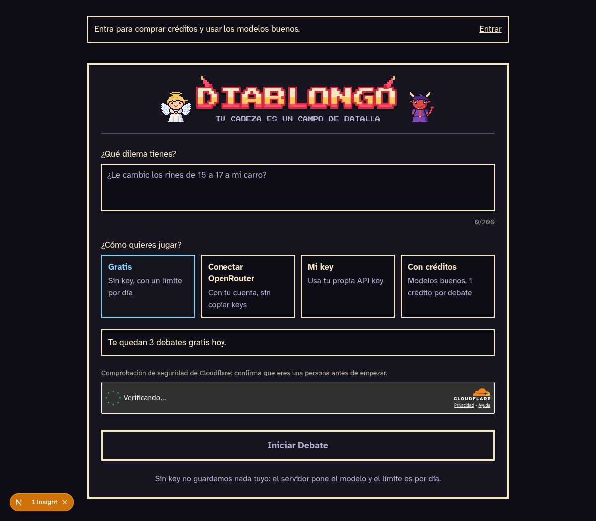

# Diablongo



**Tu cabeza es un campo de batalla.** Cuéntale tu dilema y el angelito y el Diablongo se lo pelean en frases cortas; al final tú eliges a quién le haces caso. Juego en pixel art hecho con Next.js, TypeScript y Tailwind. En vivo: [diablongo.vercel.app](https://diablongo.vercel.app).

## Características

- **Juego Ángel contra Diablo**: dos personajes pixel art debaten tu decisión; tú eliges a quién creerle.
- **Cuatro modos de juego**:
  - **Gratis**: sin key, con un límite diario por IP.
  - **Conectar OpenRouter**: tu cuenta OAuth PKCE, la key no llega a nuestro servidor.
  - **Mi key**: tu propia API key en la pestaña, opcional recordar en el dispositivo.
  - **Con créditos**: modelos mejores usando Supabase y Mercado Pago; 1 crédito por debate.
- **Cuentas opcionales**: Supabase con Google y enlace al correo; compra de créditos con Mercado Pago Checkout Pro.
- **Diseño tipo videojuego**: arena visual con animaciones, tarjetas y sprites de 32×32 en pixel art, con la marca Diablongo (paleta, logo y diseño en [DESIGN.md](./DESIGN.md)).
- **Servidor mínimo**: rutas de Next.js (App Router) en Vercel; las cuentas y el saldo viven en Supabase.

## Cómo empezar

1. Clona el repo.
2. Instala dependencias:
   ```bash
   npm install
   ```
3. Crea un archivo `.env.local` vacío o con las variables que quieras (mira **Variables de entorno**).
4. Corre en desarrollo:
   ```bash
   npm run dev
   ```
5. Abre http://localhost:3000.

## Modos de juego

### Gratis
Sin API key y sin pagar: el servidor usa su `OPENROUTER_API_KEY` y paga modelos baratos (Claude Haiku 5.5 para el Ángel, Gemini 3.1 Flash Lite para el Diablo), con modelos `:free` de respaldo (lista en `lib/gratis.ts`); 3 debates por día por IP y un cupo global diario. La configuración muestra cuántos te quedan hoy.

### Conectar OpenRouter
Conecta tu cuenta OpenRouter con OAuth PKCE en el navegador. La key solo vive en tu pestaña; nunca se envía a nuestro servidor.

### Mi key
Pega tu propia API key de OpenRouter, Google Gemini o Groq (Ollama local solo en desarrollo). Se guarda en la pestaña (`sessionStorage`); marca «Recordar en este dispositivo» para guardarla en `localStorage`.

### Con créditos
Solo aparece si las cuentas (Supabase) están configuradas; los créditos se compran con Mercado Pago. Entra con Google o un enlace al correo y juega con modelos de pago que pone el servidor. 1 crédito por debate, que se devuelve si los modelos fallan en mitad del debate. Modelos y costo en `lib/creditosDebate.ts`; paquetes y precios en `lib/paquetes.ts`.

En este modo, en Ajustes, se elige además la **personalidad** del Ángel (clásico, abuela, coach motivacional, abogado, filósofo) y la del Diablo (clásico, ex tóxico, vendedor de cripto, narco de novela, influencer), cada una por separado. La personalidad solo cambia el tono: las reglas de seguridad, la barrera de temas críticos y el revisor de frases del Diablo son las mismas para todas. Catálogo en `lib/personalidades.ts`; el servidor solo acepta personalidades del catálogo, solo en este modo, y las firma en el token del debate.

Mira **[Cuentas y créditos (docs/cuentas.md)](./docs/cuentas.md)** para la guía completa.

## Variables de entorno

En `.env.local` (desarrollo) o en Vercel (producción). Véase también [docs/cuentas.md](./docs/cuentas.md) para Supabase y Mercado Pago.

| Variable | Para qué | ¿Obligatoria? | ¿Solo servidor? |
| --- | --- | --- | --- |
| `DEBATE_TOKEN_SECRET` | Firma HMAC-SHA256 de los tokens del debate (≥ 32 bytes). Generar: `openssl rand -base64 48`. En desarrollo se inventa uno temporal | En producción | Sí |
| `OPENROUTER_API_KEY` | Key del servidor para los modos Gratis y Con créditos (y para `npm run seguridad`) | Para esos modos | Sí |
| `UPSTASH_REDIS_REST_URL` | Redis (Upstash): límite diario del modo gratis y registro de turnos jugados | En producción, para el modo Gratis (sin él responde 503; en desarrollo usa memoria) | Sí |
| `UPSTASH_REDIS_REST_TOKEN` | Token de Redis (Upstash) | Igual que la anterior | Sí |
| `LIMITE_IP_DIARIO` | Debates gratis por IP y día; por defecto 3 | No | Sí |
| `CUPO_GLOBAL_DIARIO` | Debates gratis para todos por día; por defecto 111 (1.000 llamadas de OpenRouter ÷ 9 por debate) | No | Sí |
| `NEXT_PUBLIC_TURNSTILE_SITE_KEY` | Key pública de Cloudflare Turnstile (comprobación de persona) | En producción (sin ella no empieza ningún debate) | No |
| `TURNSTILE_SECRET_KEY` | Key secreta de Cloudflare Turnstile | En producción | Sí |
| `NEXT_PUBLIC_SUPABASE_URL` | URL del proyecto Supabase | Para cuentas | No |
| `NEXT_PUBLIC_SUPABASE_PUBLISHABLE_KEY` | Key pública de Supabase (login y sesión) | Para cuentas | No |
| `SUPABASE_SECRET_KEY` | Key secreta de Supabase (mover créditos); nunca con `NEXT_PUBLIC_` | Para créditos | Sí |
| `MERCADOPAGO_ACCESS_TOKEN` | Credenciales de Mercado Pago (usar de prueba al principio) | No | Sí |
| `MERCADOPAGO_WEBHOOK_SECRET` | Clave secreta de Webhooks en Mercado Pago | No | Sí |
| `NEXT_PUBLIC_SITE_URL` | URL pública de la app (para Mercado Pago; `https://...`) | No | No |

## Comandos

```bash
npm run dev          # Desarrollo en http://localhost:3000
npm test             # Pruebas (Vitest), incluida la migración de Supabase sobre PGlite
npm run lint         # ESLint
npm run typecheck    # TypeScript
node scripts/contraste.ts      # Comprueba que la paleta cumple el contraste WCAG
node scripts/generar-iconos.ts # Regenera favicon e íconos desde el sprite del Diablo
npm run seguridad    # Prueba de seguridad de los personajes: 15 temas delicados (necesita OPENROUTER_API_KEY)
```

## Stack

- **Next.js 16** (App Router, API routes)
- **TypeScript**
- **Tailwind CSS 4**
- **Framer Motion** (animaciones)
- **Supabase** (auth, Postgres, créditos)
- **Mercado Pago** (pagos, webhooks)
- **Cloudflare Turnstile** (CAPTCHA)
- **Upstash Redis** (límite diario)

## Licencia

MIT
